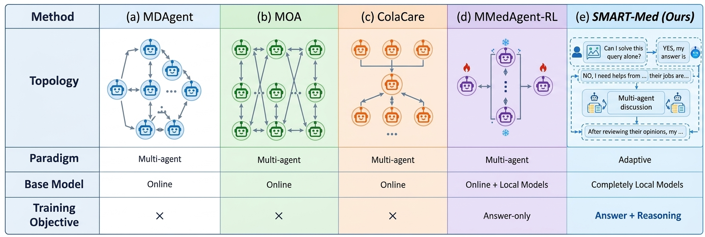

<h2 align="center">SMART-Med</h2>


<div align="center">

🌐 [Project Page](https://github.com/JayceonHo/SMART-Med) | 🎨 [Dataset](https://huggingface.co/datasets/JayceonHo/MedVR-3K) |  📄 [Paper](https://arxiv.org/pdf/2602.10179) 
</div>
<p align="center">
  
</p>


Existing multi-agent systems (MAS) for medical visual question answering (MedVQA) default to
**dense, always-on collaboration** among large, cloud-hosted models — which is costly, slow, and
raises data-privacy concerns in clinical settings. **SMART-Med** challenges both assumptions: it is
a **fully local** multi-agent method that treats collaboration as a *learnable decision* rather than
a default behavior.The key insight is that not every medical query needs multi-agent deliberation — many can be solved
reliably by a single well-trained agent, while only genuinely uncertain cases benefit from expert
collaboration. 


## Repository layout

| Path | Role |
|------|------|
| `src/smart_agent.py` | Our method  |
| `src/single_agent.py` | Single-VLM baseline (Qwen3-VL) |
| `src/dense_agent.py` | Always-on baseline |
| `src/dataset.py` | `load_data` / `create_question` for the supported benchmarks |
| `src/vlm_reward.py` | VLM reward model |
| `src/my_utils.py` | Model wrappers (`MultiModalAgent`, `Agent`), prompt templates, answer extraction |
| `dataset/` | Local data root — image/annotation paths are configured in `src/dataset.py` |

## Getting Started

### 1. Clone and set up the environment

```bash
git clone https://github.com/JayceonHo/SMART-Med.git
cd SMART-Med
python3 -m venv .venv && source .venv/bin/activate   # optional but recommended
pip install -r requirements.txt
```

Requires Python 3.10+ and a CUDA-capable GPU for inference (the backbone is Qwen3-VL-4B-Instruct).

### 2. Dataset preparation

#### MedVR-3K (training set)

**MedVR-3K**, our curated reasoning-centric dataset. It can be downloaded from
[Hugging Face](https://huggingface.co/datasets/JayceonHo/MedVR-3K). Download it into `dataset/MedVR-3K/`:

```bash
hf download JayceonHo/MedVR-3K --repo-type dataset --local-dir dataset/MedVR-3K
```

This gives `sft.jsonl`, `sft_answer.jsonl`, `judge.jsonl`, `grpo.jsonl` and `imgs/`. 

#### Evaluation benchmarks

Download each dataset from the original source and place it under `./dataset/<Name>/` following the layout below (this is the
exact layout `src/dataset.py` expects):

```
dataset/
├── Slake/
│   ├── test.jsonl              # one JSON object per line, e.g. {"img_name": "xmlab102/source.jpg", "question": ..., "answer": ..., ...}
│   ├── train.jsonl
│   └── raw_data/imgs/xmlabNNN/source.jpg
├── VQA-RAD/
│   ├── test.jsonl               # {"image_name": "synpicXXXXX.jpg", "question": ..., "answer": ..., ...}
│   ├── train.jsonl
│   └── images/synpicXXXXX.jpg
├── PathQA/
│   ├── test.jsonl                # {"img_id": "test_0167", "sent": ..., "label": {...}, ...}
│   ├── train.jsonl
│   └── raw_data/images/{train,test,val}/*.jpg
└── PMC-VQA/
    ├── test.jsonl                 # {"img_id": "PMCXXXXXXX_FigX.jpg", "question": ..., "label": ...}
    ├── train.jsonl
    └── images/PMCXXXXXXX_FigX.jpg
```

- `test.jsonl` / `train.jsonl` are the flattened QA annotation files (one JSON object per line) —
  build these yourself from each dataset's original release.
- Image paths are resolved relative to `./dataset/` in `src/dataset.py` (see `DATA_ROOT`); if your
  download uses different folder names, either rename them to match or edit `DATA_ROOT` /
  the per-dataset `img_path` construction in `create_question()`.

### 3. Run

Run the agent scripts directly from the repository root:

```bash
python src/smart_agent.py --dataset Slake --size 200 --repeat 5 --lora /path/to/lora
python src/single_agent.py --dataset VQA-RAD --model 4B-Instruct
python src/dense_agent.py --dataset PMC-VQA --answer free
```

- `--dataset`: `Slake` (default) | `PathQA` | `VQA-RAD` | `PMC-VQA`.
- Common options: `--mode` (`test` / `train`), `--answer` (`MC` for closed-form; any other value
  selects free-form questions), `--size` (questions per repeat, default 200), `--repeat` (default 3),
  and `--lora` (LoRA adapter path).
- `smart_agent.py` and `single_agent.py` additionally support `--save_name` (output folder under `./log/`).
- `single_agent.py` additionally supports `--model` (Qwen3-VL variant, default `4B-Instruct`).

**About the evaluation.** The scripts only provide a basic evaluation. For more precise evaluation especially the free-form questions, save all responses and score those saved responses with an external LLM.

## Fine-tuning

Fine-tuning uses the [ms-swift](https://github.com/modelscope/ms-swift) framework and is entirely
separate from the inference/evaluation code above. It requires `pip install ms-swift` (see
`requirements.txt`) and a CUDA GPU. All launch scripts live under `scripts/`.

The training entry points are:

| Path | Role |
|------|------|
| `scripts/sft.sh` | LoRA certainty SFT of Qwen3-VL-4B-Instruct on the prepared MedVR-3K data |
| `scripts/sft_judge.sh` | LoRA SFT of Qwen3-VL-2B-Instruct as the VLM judge |
| `scripts/grpo.sh` | GRPO fine-tuning with the medical VQA rewards |


### 1. SFT

```bash
./scripts/sft.sh
```

Trains a LoRA adapter on `dataset/MedVR-3K/sft.jsonl` (already in the `messages` + `images`
format `swift sft` expects). 

For the curriculum learning, we find that fine-tuning the model with only answers (i.e. sft_answer.jsonl) can greatly improve the model's overall performance on multi-choice questions.


### 2. VLM reasoning-quality judge

MedVR-3K offers `quality_eval` scores (logic consistency, factual correctness, image alignment)
computed during dataset curation. The prepared `dataset/MedVR-3K/judge.jsonl` can be used to train a smaller VLM and serves as the reasoning-quality reward in GRPO:

```bash
./scripts/sft_judge.sh                         
```

### 3. GRPO

```bash
VLM_JUDGE_LORA=./output/judge/v0-.../checkpoint-XXX \
GRPO_DATASET=./dataset/MedVR-3K/grpo_d3_evalfmt.jsonl \
  ./scripts/grpo.sh --adapters ./output/sft/cert_r2/v0-.../checkpoint-XXX
```

GRPO optimizes with three rewards by default:
- `medical_vqa_acc` — certainty-aware accuracy: rewards confident-correct answers, partially rewards
  uncertain-but-correct answers, and penalizes confident-wrong answers most.
- `medical_vqa_format` — small bonus for well-formed `<reason>/<certainty>/<answer>` tags.
- `medical_vqa_judge` — reasoning-quality score from the VLM judge (step 2).


Using a fine-tuned checkpoint for inference:

Point `--lora` at the resulting SFT/GRPO checkpoint directory when running `smart_agent.py` /
`dense_agent.py` (see [Getting Started](#getting-started) above).


### 4. Test the reward model

`src/vlm_reward.py` scores a single `(question, response, image)` triple. You can use the following commands:

```bash
# single sample
python src/vlm_reward.py --gpu 4 \
  --image ./dataset/MedVR-3K/imgs/train_0986.jpg \
  --question "Does an infarct in the brain show restricted diffusion?" \
  --response "<reason>...</reason><certainty>CERTAIN</certainty><answer>YES</answer>"

# batch: one {question, response, image} object per line, scores written to jsonl
python src/vlm_reward.py --gpu 4 \
  --input ./dataset/MedVR-3K/judge_example.jsonl --output scores.jsonl
```

## Citation

If you find our work helpful, we would appreciate your star and citation:

```bibtex
@inproceedings{hou2026smartmed,
  title     = {Learning When to Collaborate: Selective Multi-Agent Medical Reasoning via Uncertainty-Aware Routing},
  author    = {Hou, Jiacheng and Cui, Xueliang and Lu, Dan and Wang, Ruxin},
  booktitle = {Advances in Neural Information Processing Systems},
  year      = {2026}
}
```
